Используются 3 Алгоритма:

 

если водителей мало выигрывает перебор,
иначе кольцевой.

алгоритм с rows оказался бесполезным.

swagger уже есть. используется алгоритм ring или bruteForce.

Rows я убрал полностью и убрал бенчарки, ибо в этой задачи это не нужно
